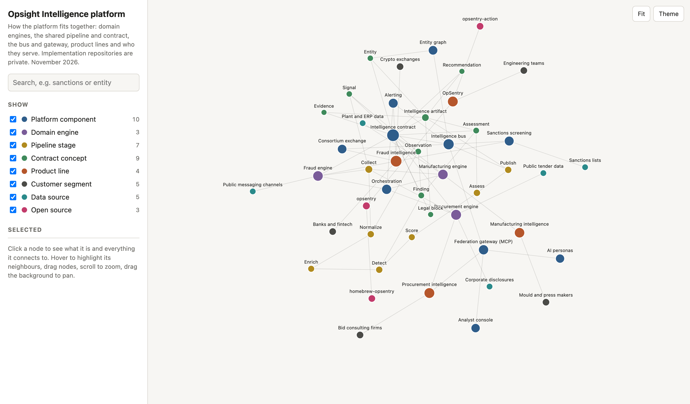

# Opsight Intelligence Platform — Architecture Overview

> A public, high-level overview of the Opsight Intelligence Platform.
> Implementation repositories are private; this document describes the
> architecture and design principles, not internal details.

<a href="https://opsight-intelligence.github.io/Opsight-Architecture-Overview/architecture.html">
  <picture>
    <source media="(prefers-color-scheme: dark)" srcset="https://raw.githubusercontent.com/opsight-intelligence/Opsight-Architecture-Overview/main/images/platform-map-dark.png">
    
  </picture>
</a>

**[Open the interactive platform map](https://opsight-intelligence.github.io/Opsight-Architecture-Overview/architecture.html)**

Opsight is a **federated multi-domain intelligence platform**. Independent
domain engines — spanning areas such as fraud, maritime, manufacturing, and
AI-governance — each run their own **collect → assess** pipeline and publish a
single, standardized **intelligence contract** to a shared bus. A federation
gateway then exposes these assessments to executive-facing AI personas.

The guiding idea is **contract-first architecture**: one shared schema, strict
separation between pure business logic and I/O, and engines that stay fully
independent while speaking the same language.

---

## Platform map

An interactive map of the platform is published at
**[opsight-intelligence.github.io/Opsight-Architecture-Overview/architecture.html](https://opsight-intelligence.github.io/Opsight-Architecture-Overview/architecture.html)**.
It shows the domain engines, the shared pipeline and intelligence contract, the bus and federation gateway, the
product lines and the customers they serve. Click a node to see everything it connects to.

OpSentry, the guardrail product for AI coding assistants, is open source:
[opsentry](https://github.com/opsight-intelligence/opsentry) and the free
[opsentry-action](https://github.com/opsight-intelligence/opsentry-action) for pull request scans.

---

## Design principles

- **Contract-first** — every engine publishes to one shared, versioned schema,
  so domains evolve independently without breaking consumers.
- **Pure core, thin I/O** — business logic is isolated from adapters
  (databases, queues, external APIs), keeping it testable and portable.
- **Dependency inversion** — the core depends on abstractions; adapters
  implement them, never the other way around.
- **Idempotent, content-addressed artifacts** — reprocessing the same input
  yields the same result, safely.
- **Single source of truth** — shared registries instead of duplicated config.

---

## System shape (conceptual)

```
                    ┌─────────────────────────────────────┐
                    │        Executive AI Personas        │
                    │  (consume structured assessments)   │
                    └──────────────────┬──────────────────┘
                                       │
                    ┌──────────────────┴──────────────────┐
                    │        Federation Gateway (MCP)      │
                    └──────────────────┬──────────────────┘
                                       │
                    ┌──────────────────┴──────────────────┐
                    │           Intelligence Bus           │
                    │   (standardized intelligence contract)│
                    └───┬───────────┬───────────┬──────────┘
                        │           │           │
                 ┌──────┴───┐ ┌─────┴────┐ ┌────┴─────┐
                 │  Domain  │ │  Domain  │ │  Domain  │   ... independent
                 │  Engine  │ │  Engine  │ │  Engine  │       engines
                 └──────────┘ └──────────┘ └──────────┘
             each: collect → normalize → enrich → detect → score → assess → publish
```

---

## Engine pipeline

Every domain engine follows the same stages, so the platform stays uniform
even as domains differ:

`collect → normalize → enrich → detect → score → assess → publish`

Each stage is small, typed, and independently testable. Engines never talk to
each other directly — they only publish to the shared bus.

---

## Tech

Python · FastAPI · Pydantic · PostgreSQL · Snowflake · Docker · MCP ·
LLM agents · GitHub Actions · pytest · Ruff

---

## Engineering discipline

- Small modules with full type hints
- Real CI gates: lint + types + tests
- Reproducible releases
- Clear boundaries between pure logic and I/O

---

*This overview intentionally omits implementation details. For questions about
the architecture, feel free to reach out.*
